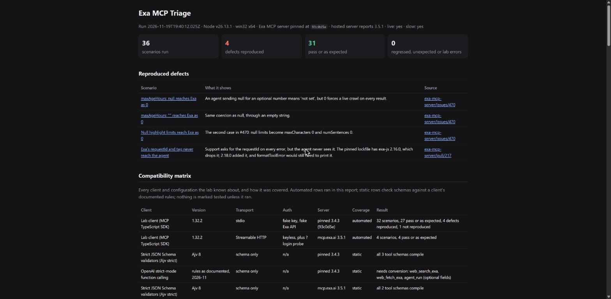

# Exa MCP Triage

When an AI agent calls Exa through MCP and something goes wrong, the error passes through several layers before anyone sees it: Exa's API, Cloudflare in front of it, Exa's MCP server, and the agent's own client. Each layer can rewrite or drop the error. By the time a developer files a ticket, all support has is the text the agent saw.

This lab breaks Exa MCP calls on purpose, one layer at a time, against Exa's real MCP server code, and records exactly what the agent ends up seeing. From that it names the layer that failed and the next step, and it measures how often that diagnosis is right.



## What it found

Run on 2026-11-15 against Exa's MCP server pinned at `93c0d5e` (v3.4.3, the latest public commit and npm release) and against production (`mcp.exa.ai`, which reports 3.5.1).

| Finding | Status | Evidence |
|---|---|---|
| Exa's `requestId` and error tag never reach the agent. Support asks for the requestId on every error. The server's lockfile pins exa-js 2.16.0, whose `ExaError` has no `requestId`; exa-js added it in 2.18.0. Even then, `formatToolError` prints only the status, message and timestamp. | Reproduced | scenario `request-id-dropped`; a bot PR (#217) tried to add the ID in March 2026 and was closed unmerged |
| `maxAgeHours: null` or `""` reaches Exa as `0`, which forces a live crawl. Null highlight limits become `maxCharacters: 0` and `numSentences: 0`. | Reproduced (#470) | three scenarios; the lab captures the request the server sends |
| The same coercion is harmless for `numResults` (0 falls back to 10) and for fields with a minimum of 1 (they fall back to undefined). So #470 matters only where 0 has a meaning. | Regression tests | `null-is-harmless-*` |
| A failed URL inside a successful `web_fetch_exa` result is a line of text, and the result is not marked as an error. | Observed | `partial-url-failure` |
| When Exa's API hangs, the server returns its own timeout error at 60s. So a 300s client timeout (#475) is not explained by a hung API call alone. | Not reproduced (#475) | `server-reports-own-timeout`, measured 62s |
| `?login` answers 401 with an OAuth challenge; plain `/mcp` answers 200 on the anonymous tier. The fix for #378 holds. | Live regression | `hosted-login-challenge`, `hosted-anonymous-tier` |
| Production runs 3.5.1, ahead of the public 3.4.3. Its `web_search_exa` adds a required `objective` argument. A keyless call without `objective` still succeeded. | Live drift | drift table in the report |
| Retry policy: a 429 is returned at once; a 5xx is retried twice. A Cloudflare 403 or 520 page is not retried, and its HTML reaches the agent inside the error text. | Regression and simulated | `rate-limit-not-retried`, `server-error-retried`, `cloudflare-*` |

A real case it explains: on 2026-11-09 my own agent got "The connector's server is rate-limiting requests" from an Exa fetch. That sentence is in no format Exa's MCP server produces, and Exa's request log has no request at that time, so the lab's rules name the client's connector, not Exa. See [docs/DEMO.md](docs/DEMO.md).

## How it works

```
scenario ──> fake Exa API, set to fail in one specific way
                 ^
                 | HTTP, via EXA_API_BASE_URL
            Exa's MCP server (real code, pinned), over stdio
                 ^
                 | MCP
            lab client (official MCP SDK) ──> observation ──> checks + diagnosis ──> report
```

Exa's server reads `EXA_API_BASE_URL`, so it can talk to a local fake API with no patching. Each scenario sets how the fake API behaves (a tagged Exa error, a Cloudflare page, a hang, a partial result), makes one MCP call, and checks what came back. `--live` adds a few calls to production on the free keyless tier, which uses no credits.

Every diagnosis names one layer:

| Layer | Meaning |
|---|---|
| client | the agent's MCP client, its config or its connector |
| network | no usable HTTP response: refused, reset, hung |
| edge | a proxy such as Cloudflare answered, not Exa's app |
| auth | the key or login was missing, wrong or blocked |
| protocol | MCP itself: unknown tool, invalid arguments |
| mcp-server | Exa's MCP server changed the request or the result |
| exa-api | Exa's API returned an error or a partial result |

The diagnosis runs in two modes. Agent view sees only what the agent saw, which is what a ticket usually contains. Instrumented mode also reads the fake API's request log (standing in for Exa's own edge and app logs) and the server's stderr: the request log decides where a request ended up, and the server log adds facts (logged errors and API warnings) and one rule (if the server logged a successful finish but the agent got an error, the error came from the client side). Each diagnosis keeps the observed facts apart from the inference, and every rule cites the line of Exa's source or the live probe it comes from.

## Run it

You need Node 20 or later and git.

```bash
git clone https://github.com/NishthaNabya/exa-mcp-triage.git
```

```bash
cd exa-mcp-triage
```

```bash
npm ci
```

```bash
npm run setup
```

```bash
npm run lab
```

`setup` clones Exa's MCP server at the pinned commit and builds it. `lab` runs every fast local scenario, repeats them three times to check that results are stable, and writes `runs/<time>.json` and `report/index.html`. It needs no API key and no network after setup. A local run takes under a minute (46 seconds on a laptop, three repeats included).

| Option | What it does |
|---|---|
| `--live` | also run against production on the free keyless tier |
| `--slow` | include scenarios that take a minute or more (#475) |
| `--only id,id` | run only these scenarios |
| `--repeat N` | runs per scenario for the reproducibility check (default 3) |
| `--list` | list all scenarios |
| `--serve id` | start one scenario's fake API, for a manual test in a real client |

Run the lab's own tests with `npm test`. On every push, `.github/workflows/ci.yml` runs setup, typecheck, tests and an offline lab run on Ubuntu with Node 20 and 22, and keeps the report as a downloadable artifact.

## How every result is labeled

| Label | Meaning |
|---|---|
| reproduced-defect | ran against the pinned code and saw the bug |
| regression | passes today and should keep passing |
| simulated | the condition was created with the fake API; shows how the server reacts, not that it happens in production |
| external-not-reproduced | a public report we could not reproduce |

Checks always state the correct behavior. A reproduced defect is a scenario whose checks fail on today's code.

## How often the diagnosis is right

Numbers from the full run (`npm run lab -- --live --slow`). Full history in [docs/ROUNDS.md](docs/ROUNDS.md).

| Set | What it is | Agent view | Instrumented |
|---|---|---|---|
| generated | the lab's own scenarios; the answer is known because we caused the failure | 28/32 | 32/32 |
| real | error text from public reports with a confirmed cause, plus the Nov 9 case | 5/5 | |
| variant-5 | 22 cases written after the last rule change and scored once, including overlapping errors and cases where the right answer is unknown | 20/22 | |

Read these numbers with their limits:
- Agent view is the number that matters for customer tickets. It uses only the text the agent saw.
- Instrumented is diagnosis with ideal internal visibility. It reads the fake API's request log, which knows whether a request reached Exa's app because the lab decided it when injecting the failure. In real support that would come from Exa's own edge and app logs. So 32/32 shows the rules are consistent with perfect logs, not that they can diagnose customer reports.
- Only variant-5 is a blind score. The real cases were read before the rules were written, and each earlier variant batch was scored blind once and then used to fix rules. The blind scores went 12/14, 10/12, 5/8, 10/11, then 20/22.

When the text cannot decide the layer, the right answer is unknown, and variant-5 includes such cases. The report counts unknown separately from a wrong layer: a wrong layer sends support the wrong way; unknown sends them to collect more evidence.

Known misses:
- Agent view cannot see #470, because the agent gets a normal result. Instrumented mode catches it.
- When the client's timeout is shorter than the server's 60s, agent view can only blame the client; the real cause is hidden.
- Blind misses still open: any unrecognized "`<tool> error: ...`" text falls back to the MCP server, which was wrong for a TLS certificate error and for Node's "operation was aborted due to timeout". And a client timeout longer than the server's limit is read as network when the honest answer is unknown. Those are the next rules to change, with a new blind batch after them.


## Compatibility matrix

Every client and configuration the lab knows about, with how it was covered. Automated rows ran in the report; static rows check the tool schemas against a client's documented rules (Ajv strict mode, OpenAI strict mode); manual rows need a person. Nothing is marked tested unless it ran.


OpenAI strict mode requires every field to be required. Exa's tools use optional fields, which is a normal design choice, so a client that turns on strict mode has to convert the schemas first. That is a compatibility note, not a bug.

## Manual client checks

Claude Desktop, Cursor and ChatGPT cannot be driven by a script. [manual/README.md](manual/README.md) has the steps: `npm run lab -- --serve <scenario>` starts a failure, you point the client at it, and you record what the client showed in `manual/results.json` with a screenshot. The report lists these separately. No client is claimed as tested until a result is recorded; none is recorded yet.

## Project layout

```
src/fake-exa/   fake Exa API: failure modes and a request log
src/targets.ts  the pinned server over stdio, and production over Streamable HTTP
src/scenarios.ts  every scenario, grouped by layer
src/observe.ts  turns one MCP call into what the agent saw
src/checks.ts   pass or fail checks over an observation
src/diagnose.ts layer diagnosis, agent view and full
src/evaluate.ts scoring and reproducibility
src/schemas.ts  strict schema checks and drift against production
src/matrix.ts   the compatibility matrix
src/report.ts   the HTML report
eval/           held-out cases, kept apart from the rules
manual/         manual client checks
scripts/        clone and build Exa's server at the pinned commit
test/           tests for the lab itself
docs/           scope, PRD, build rounds, demo
```

## Choices and limits

- The lab runs Exa's server as a separate process, the way an MCP client does, so it tests the built artifact and not private internals. Choices and rejected options are in [docs/PRD.md](docs/PRD.md).
- In our local build, the server's analytics package (Agnost) is swapped for a no-op, so test runs send nothing to a third party and stay offline. Nothing under test goes through it. Setup also installs with `--ignore-scripts` and runs the server's esbuild command directly, because its build script ends in `chmod`, which fails on Windows.
- Results describe the pinned public code. Production runs a newer version; the live scenarios and the drift table cover that gap.
- The fake API's log stands in for Exa's own logs. Instrumented mode assumes support can see whether a request reached Exa's app, as Exa's own edge and app logs would show.
- `--only` never skips the opt-in flags: a hosted scenario still needs `--live`, and a slow one still needs `--slow`.
- Simulated scenarios show how the server reacts to a condition, not how often that condition happens.
- No client other than this lab's MCP SDK client is tested automatically.
- Running the lab spends no Exa credits: the pinned server only talks to the fake API, and live checks use the keyless tier. Checked against the account's request log on 2026-11-15: no request from the lab or from Claude Code.
