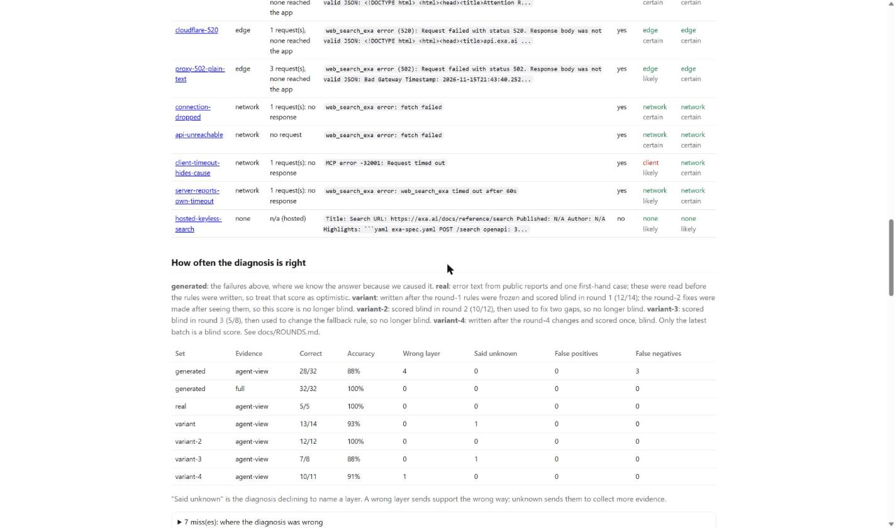
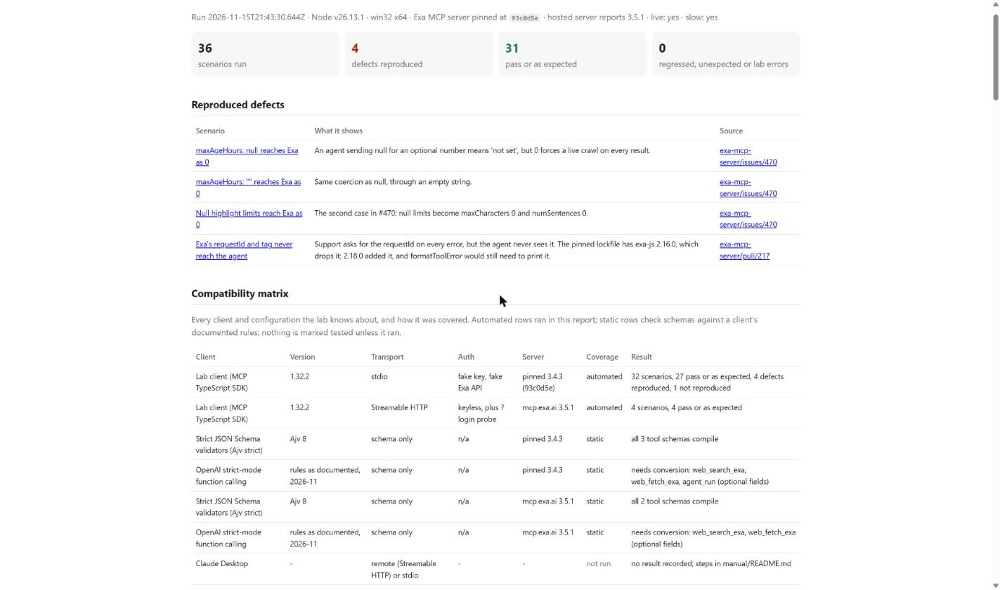

# Exa MCP Triage

## The problem

When an AI agent uses Exa through MCP, a failed request can have several causes. It might be Exa's API, a proxy in front of it such as Cloudflare, Exa's MCP server, or the agent's own client.

The hard part is that the error can change as it travels back through those layers. By the time a developer reports the problem, support may only have the error message the agent saw.

## What this project does

1. Makes an Exa MCP call fail in a controlled way, one layer at a time.
2. Records exactly what the agent receives.
3. Works out which layer caused the failure.
4. Says what support should check next, and measures how often that answer is right.

It does this against Exa's real MCP server code, not a copy, using a small local stand-in for Exa's API that fails on cue. It costs nothing to run and needs no API key.

Live report, rebuilt by CI on every push: https://nishthanabya.github.io/exa-mcp-triage/ (offline run; production checks are run locally, see below).


## One failure, start to finish

The stand-in API answers a search with a rate-limit error, exactly as Exa documents it:

```json
{ "requestId": "req_lab_trace_me", "error": "Rate limit exceeded", "tag": "RATE_LIMIT_EXCEEDED" }
```

What the agent receives from Exa's MCP server:

```
web_search_exa error (429): Rate limit exceeded
Timestamp: 2026-11-15T21:31:21.094Z
```

The request ID and the error tag are gone. The lab's diagnosis: the failure is at Exa's API (a rate limit), and because the request ID is missing, support should search Exa's request log near the timestamp instead. The full walkthrough, with two more failures, is in [docs/DEMO.md](docs/DEMO.md).

## What it found

Tested on 2026-11-15 against Exa's MCP server at commit `93c0d5e` (version 3.4.3, the latest public release) and against production at `mcp.exa.ai` (which reports 3.5.1).

| Finding | What it means | Status | See |
|---|---|---|---|
| The request ID is lost | Exa's API returns a request ID with every error, but the agent never sees it | reproduced defect | `request-id-dropped` |
| Empty values become zero | `maxAgeHours: null` reaches Exa as `0`, which forces a slow live crawl | reproduced defect (#470) | `max-age-*`, `highlight-limits-null` |
| Partial fetch failures look successful | A fetch can succeed while some of its URLs failed | simulated | `partial-url-failure` |
| Cloudflare errors reach the agent | A proxy's HTML page appears inside the MCP error text | simulated | `cloudflare-*` |
| The 300-second timeout in #475 is not a hung API call | The server reports its own timeout at 60 seconds | not reproduced (#475) | `server-reports-own-timeout` |
| OAuth login works when asked for | `?login` answers with a proper login challenge | regression, live (#378) | `hosted-login-challenge` |
| Production is ahead of the public code | Production's search tool requires a new `objective` argument | live check | drift table in the report |

More detail on the ones that matter most:

- **Request ID.** Support asks for the request ID on every error. The server's lockfile pins exa-js 2.16.0, whose error class has no request ID; exa-js added it in 2.18.0. Even then, the server's `formatToolError` prints only the status, message and timestamp. An automated PR (#217) tried to add the ID in March 2026 and was closed without merging.
- **Empty values.** Null highlight limits also become `maxCharacters: 0` and `numSentences: 0`. The same change is harmless for `numResults` (0 falls back to 10) and for fields with a minimum of 1, so #470 matters only where 0 has a meaning.
- **Retries.** A 429 is returned at once; a 5xx is retried twice. A Cloudflare 403 or 520 page is not retried.
- **A real case.** On 2026-11-09 my own agent got "The connector's server is rate-limiting requests" from an Exa fetch. That sentence is in no format Exa's MCP server produces, and Exa's request log has no request at that time, so the lab names the client's connector, not Exa.

## How it works

```
scenario ──> stand-in Exa API, set to fail in one specific way
                 ^
                 | HTTP (the server reads EXA_API_BASE_URL)
            Exa's MCP server: real code, pinned version, run locally
                 ^
                 | MCP
            lab client (official MCP SDK) ──> what the agent saw ──> checks and diagnosis ──> report
```

Each scenario sets how the stand-in API behaves (a tagged Exa error, a Cloudflare page, a hang, a partial result), makes one MCP call, and checks what came back. `--live` adds a few calls to production on Exa's free tier that needs no API key, so it uses no credits.

Every diagnosis names one layer:

| Layer | Meaning |
|---|---|
| client | the agent's MCP client, its settings or its connector |
| network | no usable response: refused, reset or hung |
| edge | a proxy such as Cloudflare answered, not Exa's app |
| auth | the key or login was missing, wrong or blocked |
| protocol | MCP itself: unknown tool, invalid arguments |
| mcp-server | Exa's MCP server changed the request or the result |
| exa-api | Exa's API returned an error or a partial result |
| unknown | the evidence does not say; better than a wrong guess |

The diagnosis can look at two amounts of evidence:

- **Agent view**: only the text the agent saw. This is what a support ticket usually contains, and it is the number that matters most.
- **Instrumented**: also the stand-in API's request log and the MCP server's own log. The stand-in API knows where each request ended up because the lab decided it, so this shows the rules working with perfect internal logs, standing in for Exa's own.

Each diagnosis keeps what was observed apart from what it infers, and every rule cites the line of Exa's source code or the live check it comes from.

Words used in this project:

| Word | Plain meaning |
|---|---|
| pinned | fixed to one exact version of Exa's code, so results repeat |
| scenario | one controlled failure plus the checks on what came back |
| held-out cases | test cases kept apart from the diagnosis rules, used only to score them |
| blind batch | new cases written after the latest rule change and scored once, before any fix |
| drift | differences between the public code and what runs in production |
| reproducibility | whether repeated runs give the same result |

## Run it

You need Node 20 or later and git.

```bash
git clone https://github.com/NishthaNabya/exa-mcp-triage.git
```

```bash
cd exa-mcp-triage
```

```bash
npm ci
```

```bash
npm run setup
```

```bash
npm run lab
```

`setup` downloads Exa's MCP server at the pinned version and builds it, once. `lab` runs every fast local scenario three times, to check that results repeat, and writes `report/index.html` and `runs/<time>.json`. It needs no API key and no network after setup, and takes under a minute.

| Option | What it does |
|---|---|
| `--live` | also check production, on the free tier that needs no key |
| `--slow` | include scenarios that take a minute or more (#475) |
| `--only id,id` | run only these scenarios; `--live` and `--slow` are still required where needed |
| `--repeat N` | how many times to run each scenario (default 3) |
| `--list` | list all scenarios |
| `--serve id` | start one scenario's failure, for a manual test in a real client |

Run the lab's own tests with `npm test`. On every push, GitHub Actions runs setup, typecheck, tests and a full offline run on Ubuntu with Node 20 and 22.

## How every result is labeled

| Label | Meaning |
|---|---|
| reproduced-defect | ran against the pinned code and saw the bug |
| regression | passes today and should keep passing |
| simulated | the failure was created with the stand-in API; shows how the server reacts, not how often it happens |
| external-not-reproduced | a public report we could not reproduce |

Checks always describe the correct behavior, so a reproduced defect is a scenario whose checks fail on today's code.

## How often the diagnosis is right

The latest blind batch: **20 of 22 correct** from the agent's text alone.

| Cases | What they are | Agent view | Instrumented |
|---|---|---|---|
| generated | the lab's own failures; the answer is known because the lab caused them | 28/32 | 32/32 |
| real | error text from public reports with a confirmed cause, plus the Nov 9 case | 5/5 | |
| latest blind batch | 22 new cases, including errors that look alike across layers and cases where the right answer is unknown | 20/22 | |

How to read these:
- Only the latest blind batch is a fair test of new errors. The real cases were read before the rules were written, and each earlier blind batch was used to fix rules after it was scored. Earlier blind scores, in order: 12/14, 10/12, 5/8, 10/11. The full history is in [docs/ROUNDS.md](docs/ROUNDS.md).
- Instrumented 32/32 shows the rules agree with perfect logs. It does not show they can diagnose a customer report.
- Saying unknown counts separately from naming the wrong layer. A wrong layer sends support the wrong way; unknown tells them to collect more evidence.

Known misses:
- Agent view cannot see #470, because the agent gets a normal result. Instrumented mode catches it.
- When the client gives up before the server's 60-second limit, the agent's text only shows a timeout, so the real cause is hidden.
- From the latest blind batch: unrecognized "`<tool> error: ...`" text is blamed on the MCP server, which was wrong for a TLS certificate error; and a long client timeout is read as network when the honest answer is unknown. Those are the next rules to change, followed by a new blind batch.



## Compatibility matrix

Every client and setup the lab knows about, and how it was covered: automated, a schema check against the client's documented rules, manual, or not run. Nothing is marked tested unless it ran.



OpenAI's strict mode requires every field to be required. Exa's tools use optional fields, which is a normal design choice, so a client that turns on strict mode has to convert the schemas first. That is a compatibility note, not a bug.

## Manual client checks

Claude Desktop, Cursor and ChatGPT cannot be driven by a script. [manual/README.md](manual/README.md) has the steps: `npm run lab -- --serve <scenario>` starts a failure, you point the client at it, and you record what it showed in `manual/results.json` with a screenshot. No client is claimed as tested until a result is recorded; none is recorded yet.

## Project layout

```
src/fake-exa/     stand-in Exa API: failure modes and a request log
src/targets.ts    the pinned server run locally, and production over HTTP
src/scenarios.ts  every scenario, grouped by layer
src/observe.ts    turns one MCP call into what the agent saw
src/checks.ts     pass or fail checks on what came back
src/diagnose.ts   the diagnosis rules, agent view and instrumented
src/evaluate.ts   scoring and reproducibility
src/schemas.ts    strict schema checks and drift against production
src/matrix.ts     the compatibility matrix
src/report.ts     the HTML report
eval/             held-out cases, kept apart from the rules
manual/           manual client checks
scripts/          download and build Exa's server at the pinned version
test/             tests for the lab itself
docs/             scope, requirements, development history, demo
```

## Choices and limits

- The lab runs Exa's server as a separate process, the way an MCP client does, so it tests the built server and not its private internals. Other choices and the options rejected are in [docs/PRD.md](docs/PRD.md).
- In the local build, the server's analytics package (Agnost) is replaced with one that does nothing, so test runs stay offline and send nothing to a third party. Nothing under test uses it. Setup also skips the server's own build script, which ends in a `chmod` that fails on Windows, and runs the same esbuild command directly.
- Local results describe the pinned public code. Production runs a newer version; the live checks and the drift table cover that gap.
- Instrumented mode assumes support can see whether a request reached Exa's app, as Exa's own edge and app logs would show.
- Simulated scenarios show how the server reacts to a failure, not how often that failure happens.
- No client other than the lab's own MCP SDK client is tested automatically.
- Running the lab spends no Exa credits: the pinned server only talks to the stand-in API, and live checks use the free tier that needs no key. On 2026-11-15 the account's request log showed no request from the lab.
