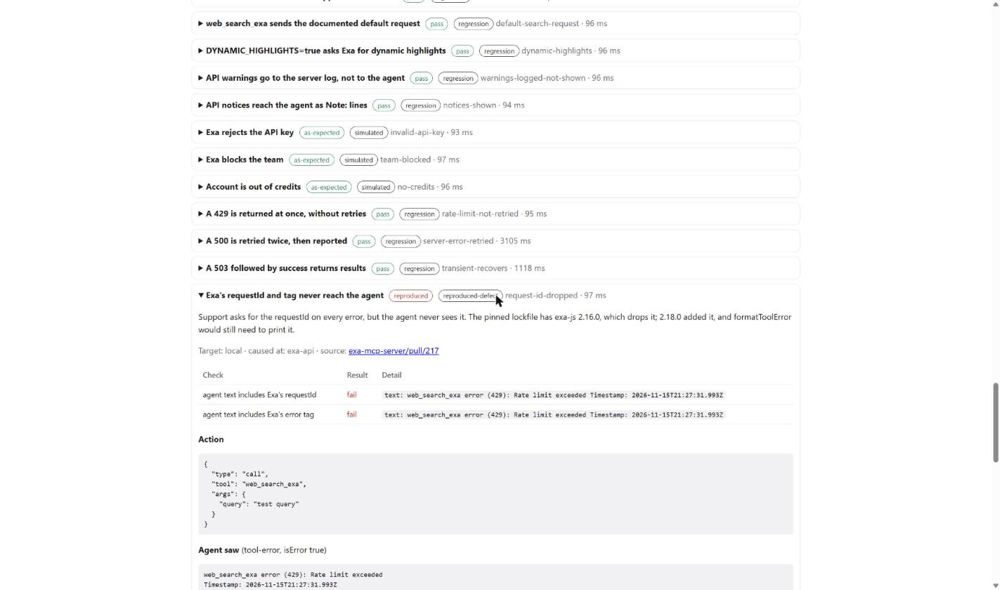

# Demo: one real failure, start to finish

This walks through the lab on three scenarios, with real output from a run on 2026-11-15.

```bash
npm run lab -- --only request-id-dropped,max-age-null-forces-livecrawl,cloudflare-403 --repeat 1
```

```
REPRODUCED   max-age-null-forces-livecrawl (109 ms)  -> none / mcp-server
REPRODUCED   request-id-dropped (96 ms)  -> exa-api / exa-api
as expected  cloudflare-403 (97 ms)  -> edge / edge
```

Each line shows the verdict, then the layer named by agent-view diagnosis and by instrumented diagnosis (which also reads the fake API's request log and the server's log).

## 1. The request ID that never arrives

The fake API answers `/search` exactly as Exa documents a rate limit:

```json
{ "requestId": "req_lab_trace_me", "error": "Rate limit exceeded", "tag": "RATE_LIMIT_EXCEEDED" }
```

What the agent got from Exa's MCP server:

```
web_search_exa error (429): Rate limit exceeded
Timestamp: 2026-11-15T21:31:21.094Z
```

Both checks fail, so the defect is reproduced: neither `req_lab_trace_me` nor `RATE_LIMIT_EXCEEDED` reached the agent.

Why: the server's lockfile pins exa-js 2.16.0. That version's `request()` reads only `error` and `message` from the body and builds an `ExaError` with no `requestId` field. exa-js added `requestId` in 2.18.0 (2026-08-13). Even with that version, `formatToolError` in `src/utils/errorHandler.ts` prints only the status, message and timestamp. A fix has two parts: bump exa-js, then print `error.requestId` (and the tag) in `formatToolError`.

The diagnosis names the layer and points support at the evidence that is there:

- Layer: exa-api, certain (HTTP 429 in Exa's error format)
- Facts: the agent's text; HTTP 429; no Exa requestId or error tag in the agent's text
- Next step: look up the status on Exa's error-codes page; the requestId is missing, so search Exa's request log near the timestamp



## 2. A success that is not what the agent asked for (#470)

The agent calls `web_search_advanced_exa` with `maxAgeHours: null`, meaning "not set". The call succeeds, so agent-view diagnosis says nothing failed. That is the honest answer from the agent's side, and it counts as a miss.

The request the server actually sent to Exa:

```json
{ "query": "test query", "type": "auto", "numResults": 10, "contents": { "text": true, "maxAgeHours": 0 } }
```

Instrumented diagnosis compares the agent's arguments with that request:

- Layer: mcp-server, certain
- Facts: Exa's log has one request (status 200); agent sent `maxAgeHours: null`; Exa received 0
- Inference: the server changed an argument before sending it to Exa, so Exa did something the agent did not ask for

This is why the lab keeps two modes: some defects are invisible from the agent's side and need the request log.

## 3. Cloudflare answers instead of Exa

The fake API returns a Cloudflare block page with a `cf-ray` header. The agent gets the HTML inside the error text:

```
web_search_exa error (403): Request failed with status 403. Response body was not valid JSON: <!DOCTYPE html> <html><head><title>Attention Required! | Cloudflare</title>...
```

Agent view says edge, because a web page came back where Exa's API returns JSON. Instrumented mode says edge with certainty, because the request never reached Exa's app. A 403 is not retried.

## The case that started this

On 2026-11-09, a `web_fetch_exa` call from my agent through Claude's connector returned:

```
The connector's server is rate-limiting requests. You can try again.
```

That text appears in no format Exa's MCP server produces (its errors start with the tool name and a status, or with "You've hit Exa's free MCP rate limit"), and Exa's dashboard showed no request at that time. The lab scores this case in its real set, where the rules name the client. The same reasoning, written down as rules and tested, is what the lab is for.
